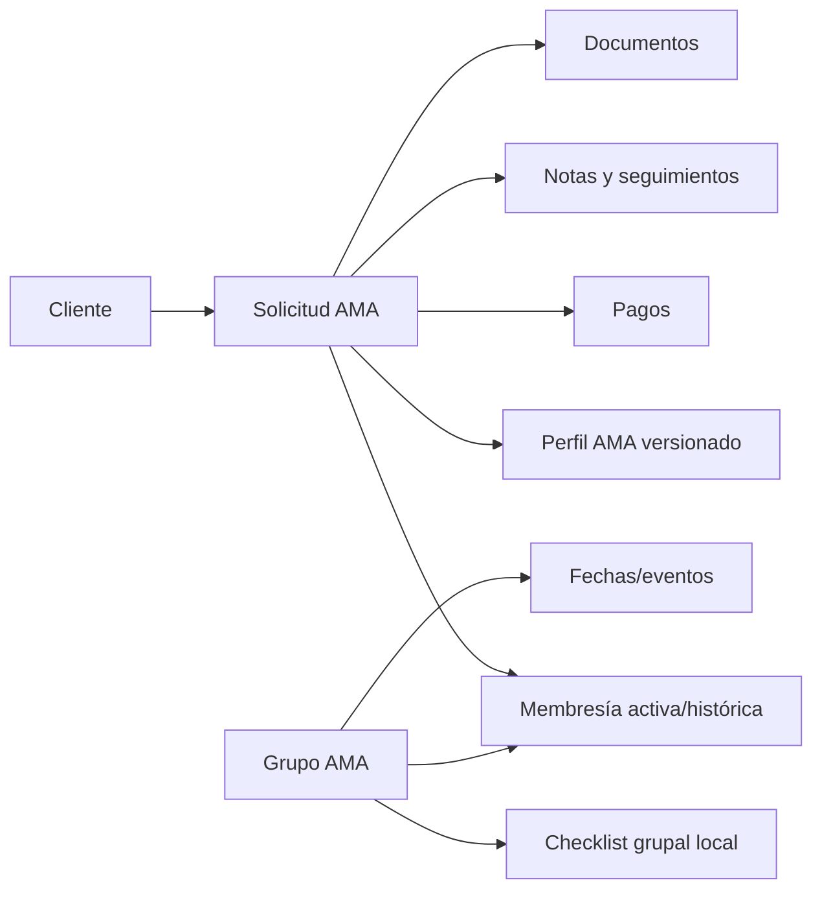

# Operación Grupos AMA dinámica — cierre 2026-09-23

## Modelo y flujo

La entidad operativa es `grupos_ama`; el integrante es una membresía de `solicitud`, no una copia del cliente ni del perfil. La relación activa queda protegida por transacción, bloqueo del grupo, validación de área AMA, elegibilidad, cupo y pertenencia. Esta auditoría corrigió el único hueco seguro: una segunda alta de la misma solicitud en el mismo grupo ahora responde error y no renueva la membresía.

## Estados e integrantes

AppSheet tiene seis estados cerrados de grupo y siete estados de integrante, además de asistencia/aprobación. El sistema actual separa estado de grupo, estado de solicitud y membresía activa. El estado grupal todavía es texto libre; cerrar su catálogo exige decidir cómo tratar valores históricos inconsistentes (`INCOMPLETO`, `YA ASISTIO`, `GRUPO TERMINADO`).

La baja es lógica (`activo=false`). AppSheet no prueba reingreso histórico; el sistema actual reactiva la fila previa y conserva que existió, pero no registra actor o motivo de cada baja/reingreso. No se añadió SQL sin una política de retención y auditoría.

## Regla de seis meses

La regla local permanece intacta. La fecha base proviene de la asignación inicial fiable; si no existe, devuelve `SIN_FECHA_BASE`. Sólo renuevan actividad: perfil realmente cambiado, documento real, pago validado, contacto/seguimiento sustantivo y cambio real de estado. Vista, login, sincronización, nota de revisor, cambio sólo de área/responsable y pago rechazado no renuevan.

El frontend informa la causa, pero el backend vuelve a calcularla dentro de la transacción y devuelve 409 si no es elegible. Los lotes se revierten completos.

## Perfil, pagos y notas

El perfil AMA se consulta y edita mediante el expediente existente, conserva versiones y no copia respuestas al grupo. Los pagos se leen del módulo 1:N por solicitud; no existe `grupo_ama.estado_pago`. AppSheet no prueba que pagar sea requisito de ingreso. Las notas conservan fecha, autor, área histórica y contenido; su creación no cuenta como actividad AMA.

## Checklist

AppSheet `check_ds` registra fecha/actividad por integrante y asesor. El checklist actual es grupal, con filas configurables, orden, fecha y usuario de completitud. Es una mejora operativa local, no una migración literal. La paridad queda parcial hasta decidir si las actividades DS deben mostrarse como checklist por integrante. Los ocho ítems predeterminados no se presentan como valores AppSheet.

## Calendario y documentos

AppSheet relaciona eventos por grupo y cinco tipos. React hoy deriva salidas tentativas/confirmadas desde el grupo; existe además un lector legacy `calendario_ama`. La navegación y aislamiento existen, pero falta una entidad canónica editable que cubra los cinco tipos, por lo que calendario queda parcial. No se mezcló con DiliTours.

Los documentos personales, del trámite y comprobantes permanecen asociados a solicitud. La exportación no demuestra archivos grupales; sus URLs legacy no se copiaron.

## Actions, procesos, slices y vistas

Se auditaron 127 actions; 42 actúan directamente sobre grupos, integrantes, calendario o realizados. Las actions de copia a terminados se rediseñan como estado/filtro. Las de Negados, Legal y logística siguen en sus módulos. Hay 2 Process Tables y 5 Outputs, pero 0 workflows declarados y definición insuficiente para reproducir Bots.

Los 5 slices se traducen a filtros. Hay 28 vistas operativas relevantes después de excluir las dos del perfil. La pantalla React cubre lista, búsqueda, filtros, creación, detalle, integrantes, elegibilidad, perfil y checklist; el calendario cubre salidas.

## Validación local

Las pruebas reproducibles cubren los 18 puntos solicitados mediante la suite de operación y las suites existentes de actividad/perfil. No se conectó a PostgreSQL real, no se ejecutó SQL de producción, no se llamó QuickBooks, no se tocó DiliTours y no se hizo deploy.

## Pendientes exactos

1. Definir catálogo/transiciones del estado del grupo y compatibilidad de valores históricos.
2. Decidir si correo, WhatsApp, locker y enlaces grupales siguen vigentes; una contraseña legacy exige diseño de secretos.
3. Decidir si `check_ds` debe exponerse como actividad/checklist por integrante.
4. Crear, en la fase global de calendario, una entidad canónica para los cinco tipos AppSheet si aún son necesarios.
5. Definir auditoría de actor/motivo para baja y reingreso antes de cambiar esquema.
6. Resolver autorización por ruta/caso en el trabajo global de autenticación.
7. Los Process Tables no permiten reconstruir eventos completos de Bots.
