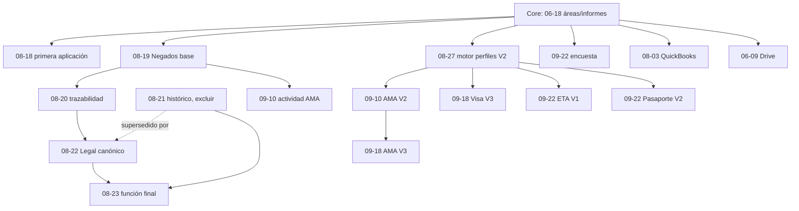

# SQL: solapamientos y orden teórico — 2026-09-24

## Inventario definitivo

Los 18 archivos permanecen untracked y nunca se verificaron contra PostgreSQL real.

| ID | Archivo | Módulo/objetos | Operaciones | Dependencia | Idempotencia | Prueba local | Real |
|---:|---|---|---|---|---|---|---|
| 1 | `2026_06_09_add_drive_metadata_to_documentos.sql` | Drive; `documentos` | ALTER | Base documentos | Parcial | Indirecta | No verificado |
| 2 | `2026_06_18_appsheet_informes_contacto_solicitudes.sql` | Informes; `contacto`, `solicitudes` | ALTER | Base core | Parcial | Contratos | No verificado |
| 3 | `2026_06_18_catalogo_areas_solicitudes_area.sql` | Áreas; `catalogo_areas`, `solicitudes` | CREATE/ALTER/INSERT/UPDATE | Base core | Parcial | Contratos | No verificado |
| 4 | `2026_08_03_quickbooks_integration.sql` | tres tablas QB | CREATE/ALTER/índices | `contacto` | Alta, DROP condicional | Unitarias | No verificado |
| 5 | `2026_08_18_solicitudes_fecha_primera_aplicacion.sql` | Solicitudes | ALTER | `solicitudes` | Alta | Indirecta | No verificado |
| 6 | `2026_08_19_proceso_negados_integral.sql` | Negados; procesos/actividades/notas/preguntas/relaciones | CREATE/INSERT/trigger | 3 | Parcial | Contratos/PG local | No verificado |
| 7 | `2026_08_20_negados_trazabilidad.sql` | Negados/Legal; `casos_legales`, seguimientos, función | ALTER/INSERT/function | 6 | Parcial | Contratos | No verificado |
| 8 | `2026_08_21_modulo_legales.sql` | Legal; procesos/casos | ALTER/constraints/index/UPDATE | 6–7 | Parcial | Contratos | No verificado |
| 9 | `2026_08_22_fix_legales_active_schema.sql` | Legal correctivo | ALTER/constraints/index/UPDATE | Alternativa mejorada a 8 | Alta-parcial | Contratos | No verificado |
| 10 | `2026_08_23_negados_legales_operational_corrections.sql` | función Negados | reemplazo de función | 7 y esquema final Legal | Parcial | Contratos | No verificado |
| 11 | `2026_08_27_perfiles_formularios_v2.sql` | repetibles/perfiles/versiones | CREATE/ALTER/DELETE acotado | Motor perfiles base | Parcial | Motor | No verificado |
| 12 | `2026_09_10_ama_actividad_notas.sql` | AMA; solicitudes/notas/trigger | ALTER/UPDATE/trigger | 3,6 | Parcial | PG local | No verificado |
| 13 | `2026_09_10_perfil_ama_v2.sql` | plantilla AMA V2 | INSERT | 11 | Baja-parcial | PG local | No verificado |
| 14 | `2026_09_18_perfil_ama_v3.sql` | plantilla AMA V3 | validación/INSERT | 11,13 | Alta | PG local | No verificado |
| 15 | `2026_09_18_perfil_visa_individual_v3.sql` | plantilla Visa V3 | validación/INSERT | 11; V2 histórica | Alta | Unitarias | No verificado |
| 16 | `2026_09_22_encuestas_satisfaccion.sql` | encuesta | CREATE/ALTER/índices | clientes/solicitudes/empleados | Alta | Unitarias | No verificado |
| 17 | `2026_09_22_perfil_eta_v1.sql` | plantilla ETA V1 | validación/INSERT | 11 y catálogo ETA | Alta | Unitarias | No verificado |
| 18 | `2026_09_22_perfil_pasaporte_v2.sql` | plantillas Pasaporte MX/GT V2 | validación/INSERT | 11 y plantillas V1 fuente | Alta | Unitarias | No verificado |

## Los cinco archivos solapados

| Archivo A | Archivo B | Objeto compartido | Tipo | Semántica y riesgo |
|---|---|---|---|---|
| 08-19 | 08-20 | `asegurar_proceso_negados()` | MISMA FUNCIÓN, DEPENDENCIA DE ORDEN | 08-20 reemplaza la función y agrega seguimiento sólo al crear proceso; ambos son necesarios en orden si se instala la base completa. |
| 08-20 | 08-23 | `asegurar_proceso_negados()` | MISMA FUNCIÓN, REEMPLAZO | 08-23 sustituye `ON CONFLICT (columnas)` por `ON CONFLICT DO NOTHING` para convivir con índices parciales del esquema Legal final. Debe ser posterior. |
| 08-19 | 08-23 | función/trigger Negados | MISMO OBJETO | 08-23 es la revisión final, pero no crea todas las tablas/trigger base; no sustituye por sí solo a 08-19. |
| 08-21 | 08-22 | tablas, columnas, constraints e índices Legal | DUPLICADO/ALTERNATIVA | 08-22 declara expresamente corregir una base que no recibió 08-21; repite casi todo y mejora FKs/índice de origen. No deben aprobarse ambos automáticamente. |
| 08-21 | 08-22 | `ux_casos_legales_negados_proceso` | ÍNDICE INCOMPATIBLE EN SECUENCIA | 08-21 conserva unicidad; 08-22 la elimina y crea índice no único porque origen es trazabilidad. El resultado final pretendido parece ser 08-22. |

Los cinco archivos afectados son 08-19, 08-20, 08-21, 08-22 y 08-23. Semánticamente hay tres archivos con solapamiento ordenado sobre la función Negados y dos archivos que representan versiones alternativas de la migración Legal.

## Decisión semántica

- **08-19 → 08-20 → 08-23:** complementarios y secuenciales; la última definición de función debe prevalecer.
- **08-21 frente a 08-22:** `2026_08_22_fix_legales_active_schema.sql` es la migración canónica para una instalación nueva. El propio archivo se declara correctivo del esquema activo que no recibió 08-21, conserva las columnas y relaciones necesarias, mejora las guardas de claves foráneas y corrige el índice de origen para tratarlo como trazabilidad. `2026_08_21_modulo_legales.sql` queda como antecedente histórico y debe excluirse del futuro staging.
- No hay incompatibilidad final demostrada entre Negados y 08-22 si se respeta el orden y 08-23 queda al final.

## Versiones de perfiles

AMA Legacy/V2/V3, Visa Individual V2/V3, Pasaporte V1/V2 y ETA V1 son versiones históricas o fuentes distintas. Compartir `perfil_plantillas` no las convierte en duplicados. El motor elige la versión activa más alta y conserva respuestas/versiones históricas.

`2026_08_27_perfiles_formularios_v2.sql` debe preceder a todas las plantillas con repetidores. Familiares, redes sociales e ingresos son estructuras JSON/repeaters apoyadas en `perfil_respuestas_repetibles`; no requieren migraciones físicas separadas.

## Encuesta

Sólo `2026_09_22_encuestas_satisfaccion.sql` toca `encuestas_satisfaccion` dentro de los 18 SQL. Su CREATE seguido de ALTER permite compatibilidad con una tabla previa. No hay solapamiento con otra migración del conjunto, aunque las FKs exigen core existente.

## DAG teórico

Orden lineal candidato para ensayo: 3 → 2 → 5 → 1 → 11 → 6 → 7 → **9 (08-22; excluir 8/08-21)** → 10 → 12 → 13 → 14 → 15 → 17 → 18 → 16 → 4. El orden de Drive, encuesta y QuickBooks puede variar después de sus dependencias base.

## Resumen

Las categorías principales son mutuamente excluyentes por archivo; “requieren revisión” es un indicador adicional.

| Categoría | Archivos |
|---|---:|
| SQL TOTALES | 18 |
| SIN CONFLICTO | 4 |
| ORDEN IMPORTA | 9 |
| SOLAPAMIENTO REAL | 3 |
| DUPLICADOS/ALTERNATIVOS | 2 |
| INCOMPATIBLES | 0 |
| REQUIEREN REVISIÓN EN STAGING | 5 |

La decisión documental pendiente queda cerrada: 08-22 es canónico y 08-21 queda supersedido. Este orden no constituye aprobación de ejecución; aún se deben conciliar objetos, constraints y datos contra staging mediante consultas read-only.
