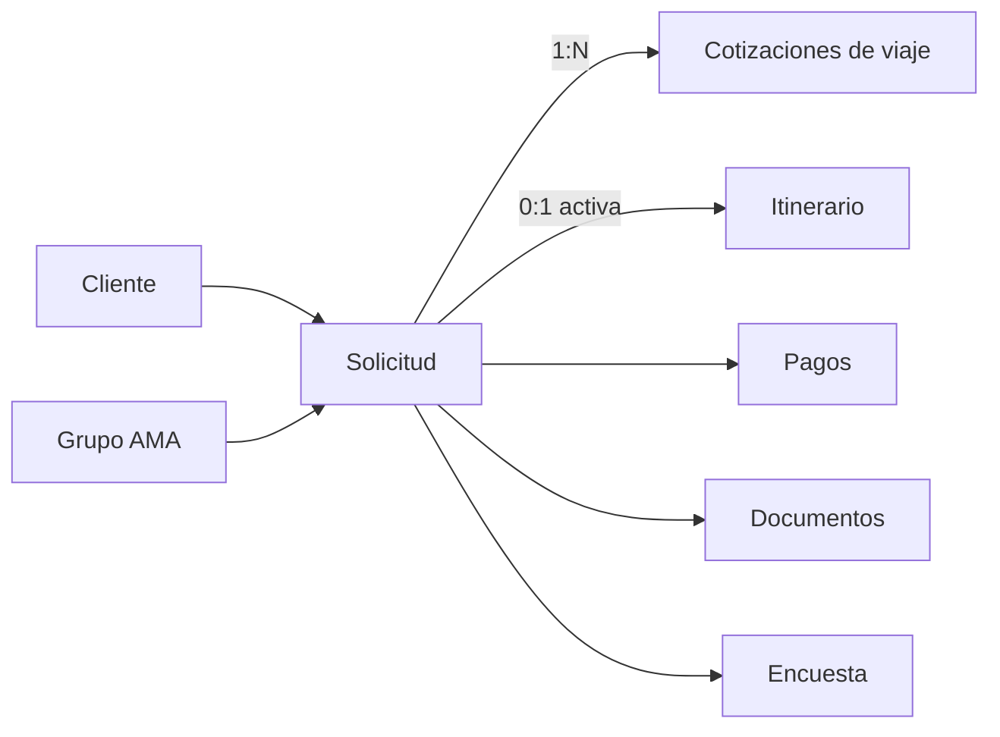

# DiliTours / Logística dinámica — cierre 2026-09-23

## Modelo actual

El modelo actual es una fase inicial segura: conserva clientes y solicitudes canónicas, varias cotizaciones y un itinerario activo. No copia perfiles AMA, pagos ni encuestas. React ofrece operación de cotizaciones/itinerarios, una bandeja por área y calendario de salida/regreso.

## Diferencia frente a AppSheet

AppSheet representa cotización de vuelo, itinerario, vuelos, aeropuertos, aerolíneas, reservas de hotel y detalles como entidades relacionadas. También contiene un flujo terrestre independiente con cliente turístico, vehículo, cotización, pago y tour. El modelo nuevo aplana vuelo/hotel/transporte dentro del itinerario y no admite pasajeros externos o múltiples. Por ello no puede declararse paridad completa.

El flujo comprobado es: origen AMA/individual → expediente logístico → alternativas de cotización → aceptación/cancelación → itinerario asociado a cotización → vuelos/reserva hotel → operación/cierre. En paralelo: cliente turístico → cotización de vehículo → pago → tour/calendario. No se conectó el sitio público.

## Estados y finanzas

Los nueve estados de `logistica_viajes` se mantienen documentados por separado de cotización, hotel, itinerario, tour y pago. El backend usa estados propios cerrados de cotización e itinerario, pero permite cambiarlos sin una transición auditada. Antes de cerrarlos debe resolverse compatibilidad histórica.

AppSheet calcula ganancia de logística y una cotización terrestre extensa. El backend sólo guarda monto estimado y moneda. Pagos turísticos deben reutilizar el ledger general con vínculo/concepto de cotización; no se creó otro sistema financiero.

## Integraciones

AMA se relaciona mediante solicitud y membresía; el perfil no se copia. La encuesta existente se reutiliza. Documentos permanecen por solicitud, aunque todavía falta distinguir PDF de cotización, itinerario, boleto y voucher. Las actions externas de correo, SMS y WhatsApp y los procesos PDF no se implementaron automáticamente.

## Pruebas y seguridad

Las pruebas locales verifican las 15 capacidades soportadas o brechas contractuales: creación, cliente, servicio, precio, estado, aceptación, itinerario, vuelo, hotel, transporte, pasajero, pago, documento, calendario y aislamiento. No se conectó PostgreSQL real, no se ejecutó SQL, no se modificó el sitio público y no hubo deploy.

## Pendientes exactos

1. Definir persona/pasajero para viajeros que no son clientes migratorios.
2. Diseñar `cotizacion_items` para combinar vuelo, hotel, transporte, tour u otro.
3. Relacionar itinerario con la cotización aceptada.
4. Modelar segmentos de vuelo y catálogo de aeropuertos/aerolíneas.
5. Modelar reserva hotel 1:N detalles/habitaciones.
6. Definir transporte, vehículos y proveedores vigentes.
7. Modelar grupo de viaje y pasajeros 1:N sin equipararlo a Grupo AMA.
8. Vincular pagos y documentos generales a cotización/itinerario con conceptos auditables.
9. Decidir si catálogos turísticos alimentan el sitio público.
10. Definir catálogo/transiciones históricas por dominio.
11. Resolver permisos en la auditoría global de autorización.
12. La exportación no permite reconstruir completamente los procesos PDF/Bots.
