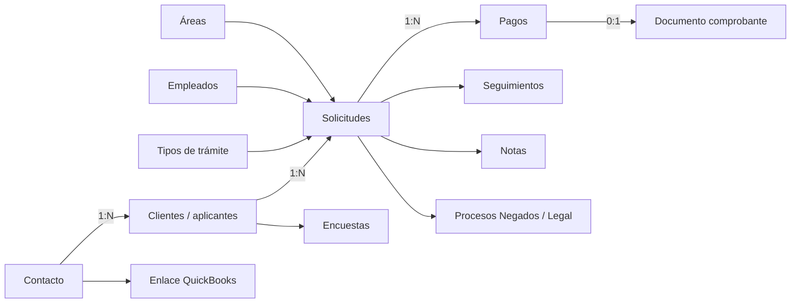

# INFORMES Y PAGOS dinámico — cierre 2026-09-23

## Modelo nuevo

La entidad inicial es `contacto`. Un contacto puede tener varios clientes/aplicantes, y cada aplicante puede tener múltiples solicitudes sin sobrescribir las anteriores. INFORMES desaparece correctamente como tabla monolítica: sus datos personales pertenecen al cliente, su interés concreto a la solicitud, el catálogo a tipos de trámite, su cobro a pagos y su historial a seguimientos.

## Equivalencias operativas

Las actions AppSheet que copiaban una fila a AMA, Visa individual, Pasaporte, ETA, Visa canadiense o Legal expresaban un cambio de responsabilidad y el inicio de un proceso. El sistema nuevo conserva una solicitud, mueve su área, asigna responsable y registra seguimiento. Negados y Legal usan procesos hijos cuando requieren trazabilidad especializada.

Cambiar o agregar un servicio no debe reescribir una solicitud histórica. `createSolicitudForCliente` genera otra instancia para el mismo aplicante; `solicitudes_relaciones` enlaza reaplicaciones o servicios legales cuando existe una semántica comprobada.

## Contactos y fichas

El listado de contactos permite buscar por nombre, teléfono y correo; calcula cantidad de aplicantes, solicitudes y último movimiento. La ficha devuelve contacto, aplicantes, solicitudes por aplicante e historial. La ficha del cliente reúne contacto, solicitudes, responsable, área, perfil, avance documental, pagos, encuesta y procesos especializados mediante las pantallas ya integradas.

AppSheet no documenta origen, medio, ubicación u observaciones propios del CONTACTO. Esos conceptos aparecen en solicitud/cliente o no tienen evidencia suficiente para agregarse al contacto.

## Pagos

El modelo nuevo corrige la principal limitación de AppSheet. Cada pago conserva solicitud, cliente, monto, moneda, concepto, método, referencia, fecha, estado, responsable de registro, responsable de validación, observaciones y comprobante. Una solicitud puede tener varios pagos; ninguno sobrescribe al anterior.

Los estados de pago son `registrado`, `validado` y `rechazado`. El estado de la solicitud se mantiene separado. Validación y rechazo usan transacción y bloqueo de fila; la repetición de una decisión ya aplicada devuelve el pago sin modificar fechas ni insertar otro seguimiento. Esta auditoría añadió la idempotencia que faltaba al rechazo repetido.

AppSheet distingue anticipo y pago completo mediante campos en distintas hojas, pero no documenta monto total ni saldo. El sistema puede registrar ambos como conceptos separados; no se agregó cálculo de saldo contractual.

## Documentos y encuesta

Los 12 File de INFORMES se traducen al módulo general de documentos asociado a solicitud. Un comprobante de pago es un documento general enlazado desde el pago, almacenado en la carpeta Pagos. Los requisitos específicos siguen definidos por plantillas comprobadas; no se trasladaron IDs opacos de AppSheet.

La encuesta de satisfacción permanece como entidad independiente relacionada con cliente y opcionalmente solicitud. No se creó otra implementación desde Informes/Pagos.

## QuickBooks

La exportación AppSheet sólo prueba la existencia de un proceso `QBKS_INF` y una salida opaca. No revela payload, endpoint, identificador externo ni deduplicación. Por ello su paridad histórica es **PARCIAL**.

La implementación actual sincroniza el contacto como Customer, incluye aplicantes y trámites relacionados, guarda Customer id/SyncToken/realm, serializa por contacto con advisory lock, busca por DisplayName antes de crear y mantiene estados de sincronización. No se modificó ni se llamó a QuickBooks durante esta auditoría.

## Actions, procesos, slices y vistas

Se revisaron 120 actions; 68 son relevantes para alta, contacto, archivos, cobro, historial o envío a áreas. Los 7 slices representan colas de cobro y se resuelven con filtros de Finanzas. De 63 vistas, 34 tienen intención relevante; React las concentra en Contactos, ficha del cliente/solicitud y Finanzas.

La exportación declara 0 workflows. Sus 22 tablas técnicas muestran artefactos de ejecución, pero no una definición completa de Bots. No se recrearon automatizaciones externas ni tablas de proceso AppSheet.

## Pruebas locales

- `informesPagosParity.test.js`: fuente AppSheet, relaciones, pagos, documentos, encuesta, historial, QuickBooks y rechazo idempotente.
- `informesPagosFlow.test.js`: los 15 pasos solicitados desde contacto hasta integraciones Negados/Legal.
- `informesPagosContracts.test.js`: contratos frontend de contacto, aplicante, solicitud y pagos.
- Regresiones: encuestas, Negados, Legales y QuickBooks.

No se conectó a PostgreSQL, no se ejecutó SQL, no se llamó QuickBooks y no se hizo deploy.

## Pendientes exactos

1. Definir reglas contractuales de precio y saldo antes de calcular liquidación.
2. Decidir cuándo un `TRAMITE ADICIONAL` legacy es una nueva solicitud relacionada.
3. Completar el mapeo de documentos requeridos sólo para trámites con reglas AppSheet identificables.
4. Resolver autorización por ruta/caso dentro del trabajo global de autenticación.
5. Mantener DELETE físico fuera del flujo hasta definir retención global.
6. La fuente AppSheet no permite certificar el evento ni payload histórico de QuickBooks.
