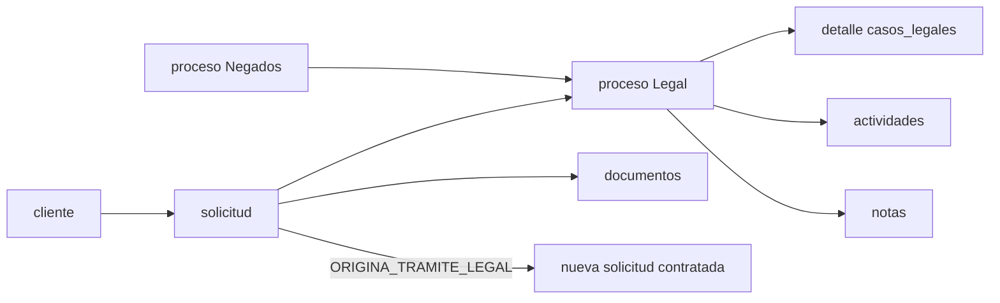

# LEGALES dinámico — cierre 2026-09-23

## Modelo conceptual

La arquitectura vigente representa la entidad principal como `procesos_solicitud(tipo_proceso='LEGAL')`. Su PK es `id_proceso`; la entidad padre es `solicitudes`, que a su vez pertenece a un `cliente`. `casos_legales` es el detalle compatible 1:1 por `id_proceso_legal`. Un proceso puede tener responsable, actividades, notas y seguimientos, y puede apuntar al proceso Negados que lo originó.

Esto evita duplicar aplicantes. La solicitud original permanece intacta cuando Legal origina un servicio contratado.

## Comportamiento representado

- Listado operativo con nuevos, en proceso, falta de cobro, FOIA, FOIA especial AMA, Negados grupo/individual y terminados.
- Búsqueda por persona, solicitud, cliente, teléfono o expediente; filtros por origen, estado, responsable, resultado, gestión, fechas, tipo y solicitud relacionada.
- Asignación a empleados canónicos, próxima gestión, actividades históricas y notas históricas por proceso.
- Estados `PENDIENTE_ASIGNACION`, `EN_ANALISIS`, `ESPERANDO_INFORMACION`, `ESPERANDO_CLIENTE`, `RESUELTO`, `CERRADO`; no se fuerza un flujo lineal donde AppSheet no lo prueba.
- Resultados `CANDIDATO`, `NO_CANDIDATO`, `REQUIERE_NUEVO_TRAMITE`, `REGRESA_ORIGEN`, `OTRO`.
- Cierre sin borrado, regreso trazable a Negados y creación idempotente de una solicitud contratada mediante `solicitudes_relaciones`.
- Documentos y pagos reutilizan los módulos generales de la solicitud. AppSheet sólo aporta una URL de expediente y fechas manuales de pago.

## Negados y origen del caso

AppSheet prueba una relación selectiva: sólo las filas Negados cuyo estatus es `Asesoría legal` aparecen en las colas Legal. No prueba que todos los negados se envíen ni que se copie una fila a `legal`. En el sistema nuevo la acción explícita `sendLegal` crea, una sola vez, un proceso hijo Legal y un detalle `ANALISIS_NEGADOS`; el proceso Negados continúa como origen y conserva su historial.

Al terminar, `REGRESA_ORIGEN` cierra Legal y registra el regreso. `REQUIERE_NUEVO_TRAMITE` puede crear una solicitud nueva relacionada. Ninguna operación convierte o sobrescribe la solicitud negada.

## Estados, pagos y continuidad

AppSheet mezcla estados operativos y financieros en `estatus`. La implementación separa responsabilidades: el proceso conserva su estado Legal, `pagos` determina cobro y una solicitud relacionada representa el trámite contratado. Esta separación conserva las intenciones de `PROCESO DE PAGO`, `Necesita Pago` y `area_continuacion` sin duplicar datos financieros.

El cierre significa que el análisis dejó de estar activo y conserva `fecha_salida`, resultado, resolución e historial. No se atribuye automáticamente a cerrado el significado de aprobado, abandonado o completado; el resultado lo especifica.

## Formularios, documentos, citas y automatizaciones

La exportación no contiene cuestionarios específicos por tipo Legal. Tampoco documenta audiencias, citas, cartas, checklist de documentos requeridos, fundamentos múltiples o una bitácora de análisis. Por eso no se generaron plantillas ni entidades nuevas.

Los archivos continúan asociados a la solicitud en el módulo general. Esto aísla Cliente A de Cliente B y una solicitud de otra, pero dos procesos Legal históricos sobre la misma solicitud comparten ese expediente documental. Se conserva como diferencia parcial porque AppSheet tampoco ofrece una relación de archivo por caso que permita migrarla sin inventar reglas.

Los dos recordatorios AppSheet calculan 120 días desde `fecha_envio_solicitud` y sólo habilitan marcas manuales. El sistema soporta fechas de próxima gestión y actividades, pero no posee un equivalente inequívoco de `fecha_envio_solicitud`; automatizar los 120 días requeriría definir el evento de partida. No se creó un bot.

## Acciones y vistas

Se auditaron 20 actions relevantes: 12 sobre `legal`, 2 de cierre en Negados y 6 del subflujo FOIA. Las ocho vistas de menú se traducen a filtros del listado; las vistas Detail/Form/Inline generadas se traducen a la ficha integrada de solicitud y a `LegalProcessCard`. Los slices no se materializan como tablas.

## Seguridad y conservación

Las rutas Legal usan la protección global existente, pero no se encontró middleware de autorización por caso ni equivalencia directa del Show If de AppSheet. Esta deuda pertenece a autenticación global y queda fuera del alcance. Los filtros de origen y resultado ahora rechazan valores fuera de catálogo antes de consultar datos.

AppSheet ofrece Delete estándar. El sistema no expone borrado físico de casos Legal y conserva procesos, notas, actividades y relaciones. Esta diferencia es deliberada hasta que exista una política global de retención.

## Validación

- Backend: `backend/test/legalesParity.test.js` cubre origen, cliente, solicitud, tipo, estados, transiciones, responsable, notas, historial, documentos, aislamiento, solicitudes relacionadas, cierre, filtros y compatibilidad histórica.
- Frontend: `LegalProcessCard.test.jsx` cubre detalle activo, ocultamiento de acciones en cerrado y ausencia de tarjeta sin caso activo.
- Regresión: se ejecuta `negadosParity.test.js` porque existe integración Negados→Legal.
- No se conectó a PostgreSQL, no se ejecutó SQL y no se hizo deploy.

## Pendientes exactos

1. Definir qué evento canónico equivale a `fecha_envio_solicitud` antes de automatizar los dos recordatorios de 120 días.
2. Decidir si documentos futuros deben asociarse opcionalmente a `id_proceso` cuando una solicitud tenga varios casos Legal históricos.
3. Definir el origen y permisos de un alta Legal manual antes de exponer el EnumList de 20 tipos.
4. Resolver autorización por caso dentro del trabajo global de autenticación.
5. Mantener DELETE físico fuera del módulo hasta definir la política global de retención.
