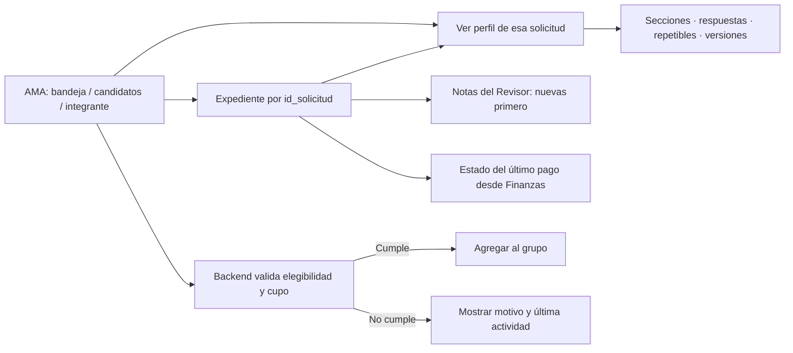

# AMA / Perfiles: auditoría previa a implementación

Fecha: 2026-09-07. Estado: implementación detenida por la excepción explícita del requerimiento sobre una regla crítica no determinable. No se modificó código de aplicación ni se ejecutaron migraciones, seeds o escrituras en PostgreSQL.

## Evidencia y límites

Se inspeccionaron las pantallas AMA, grupos, ficha de aplicante, expediente, renderer de perfiles, servicios Axios, rutas y servicios de solicitudes, perfiles, seguimientos, pagos y los usos de notas/actividades de Negados y Legal. Se extrajo el texto de los seis PDF locales de Formularios, Grupos AMA, Informes, Negados, Legales y Visas individuales. La revisión de referencias cruzadas no equivale a una certificación exhaustiva de todos sus formularios.

Los PDF de Formularios e Informes indican 17/08/2026. No hay en el adjunto recibido una captura de Notas del Revisor ni acceso al AppSheet vigente. La documentación no se considera prueba de su estado actual.

PostgreSQL: el primer intento de consultar exclusivamente `information_schema.columns` devolvió EACCES; el segundo, con ejecución ampliada, agotó el tiempo de conexión. Los nombres siguientes están comprobados en código/SQL local; su existencia, columnas y datos desplegados siguen pendientes de verificación. No se leyó información personal de la base.

Hay numerosos cambios previos y archivos sin seguimiento en el repositorio. No se revirtieron ni se incorporaron a commits.

## 1. Hallazgo crítico: seis meses

En `Application Documentation Formularios.pdf`, página 179, `APLICANTES AMA PERFILES` contiene la columna virtual **Excedió los 6 meses**. La fórmula visible es incompleta:

```text
=IF(EOMONTH([FECHA ASIGNACION DE ASESOR],6)
```

Se renderizó e inspeccionó visualmente la página: la truncación también existe en el PDF, no sólo en el texto extraído. Evidencia: `backend/reports/ama-audit/formularios-p179.png`.

La página 172 asigna `FECHA ASIGNACION DE ASESOR` cuando hay asesor y la fecha está vacía; de otro modo conserva la fecha previa. La página 424 contiene una regla visual de recordatorio de llamada basada en `Excedió los 6 meses`. Esto demuestra una referencia temporal de asesoría y un recordatorio; no demuestra el bloqueo solicitado de alta a grupo ni qué eventos lo reinician.

En PostgreSQL/código, `solicitudes.fecha_ultimo_movimiento` se actualiza al mover de área, enviar tras pago, registrar seguimiento operativo y validar/rechazar pagos en las ramas correspondientes. No representa toda modificación: guardar un perfil, registrar un documento o crear un seguimiento genérico no actualiza necesariamente esa columna. `actualizado_en` tampoco ofrece una semántica uniforme de actividad de negocio.

**Definición necesaria:** confirmar qué eventos reinician los seis meses para la nueva restricción. No se puede elegir entre fecha de asesoría, movimiento operativo, contacto con el cliente o cualquier edición sin cambiar el resultado de elegibilidad. También deberá quedar documentado el tratamiento de fechas ausentes y el cómputo de meses calendario frente al fin de mes histórico.

## 2. Comparación y alcance propuesto

| Aspecto | AppSheet documentado | React/backend actuales | Adaptación pendiente |
|---|---|---|---|
| Acceso al perfil | `REF_ROWS("PERFILES AMA", "ID APLICANTE")`, p. 178 | AMA abre expediente por `id_solicitud`; expediente permite ver/editar perfil y versiones | Agregar acceso claro desde bandeja, candidatos e integrantes y abrir el perfil de esa solicitud |
| Motor | Preguntas y referencias a tablas | `perfil_plantillas`, respuestas JSON, versiones y motor V2 con repetibles | Conservar el motor y claves históricas; adaptar plantilla AMA |
| Otro nombre | Yes/No; detalle LongText con Show_If, pp. 17–18 | Seed AMA usa select, etiqueta abreviada «¿Cuál?», sin condición, e intercala Sexo | Recuperar etiqueta, orden, tipo y condición documentados |
| Obligatorios | El detalle de otro nombre tiene `Required_If: null` | Seed AMA declara campos opcionales | No convertir Show_If en obligatoriedad sin evidencia adicional |
| Estado civil | CASADO/A, VIUDO/A, SOLTERO/A, DIVORCIADO/A, LEGALMENTE SEPARADO/A, UNION LIBRE | Seed usa otra capitalización, orden y «Separado/a» | Mapear sin perder respuestas anteriores; no normalizar destructivamente |
| Familiares | Tabla relacionada `FAMILIARES EN EE. UU`, actualizable | Seed AMA conserva detalles como texto; motor V2 soporta repetibles | Mapear referencia y mantener texto histórico al incorporar repetibles |
| Notas | `NOTAS DEL APLICANTE` es texto editable, p. 171 | «Notas del Revisor» muestra sólo `solicitudes.observaciones` | Historial reutilizando `notas_solicitud`; conservar observación heredada |
| Autor/fecha de nota | No queda demostrado un historial de notas equivalente | La tarjeta muestra encargado actual y fecha de actualización del expediente | No presentarlos como autor/fecha probados de una nota histórica |
| Lectura de notas | No se certificó acceso actual desde estos PDF | La tarjeta del expediente no filtra por autor; notas de Legal/Negados se consultan por proceso | Lectura bajo el acceso existente al expediente, sin filtro por autor |
| Pago | `ESTATUS DE PAGO` y `PAGO REALIZADO` son Text, sin Enum en bloques revisados | Finanzas usa `registrado`, `validado`, `rechazado`; AMA no los muestra | Consultar `pagos` por solicitud y mantener esos valores |
| Seis meses | Fecha de asesoría, fórmula incompleta y recordatorio | Alta a grupo valida área, cupo y pertenencia; no antigüedad | Pendiente de definición crítica; validación central de backend y explicación en React |
| Edición | PERFILES AMA y APLICANTES AMA PERFILES permiten ALL_CHANGES | Edición de perfil, aplicante, solicitud y grupo existente | Reutilizar edición y versiones; no hacer editable toda la pantalla |

La implementación final aún no existe. Esta tabla distingue hallazgos de cambios propuestos.

## 3. Notas, pagos y trazabilidad

`notas_solicitud` ya define `id_nota`, `id_solicitud`, `id_proceso` opcional, `id_empleado` opcional, `contenido`, `contexto`, `creado_en` y `actualizado_en`. No hace falta inventar una entidad AMA paralela. Legal y Negados insertan notas; no exponen edición de esas notas en los servicios revisados. La edición del texto AppSheet no demuestra una política de edición del futuro historial. La operación existente de agregar notas es reutilizable como patrón, manteniendo correcciones como nuevas entradas mientras no exista otra regla confirmada.

La tabla no almacena un área histórica de la nota. Consultar `empleados.area` da el área actual y puede cambiar; tampoco permite atribuir con certeza autor o área a observaciones antiguas. Deben distinguirse datos desconocidos y actuales de datos históricos comprobados.

Finanzas ya selecciona el último pago por `creado_en DESC NULLS LAST, id_pago DESC`, por solicitud. Puede reutilizarse este criterio y etiquetarlo como estado del último pago. `validado` no equivale a liquidación total: no se encontró en este flujo una fuente de saldo que justifique mostrar «Pagado/Parcial/Pendiente». La visualización debe refrescar desde Finanzas, sin segundo estado manual.

## 4. Archivos a modificar después de resolver la regla

- `diligenciasinternacionalesinc/src/Components/AreaBandeja/AreaBandejaPage.js`: acceso al perfil acotado a AMA.
- `diligenciasinternacionalesinc/src/Pages/Empleado/GruposAmaPage.js`: perfil, pago y elegibilidad en candidatos/integrantes. También se detectó que `Number(null)` convierte cupo no definido en cero en la validación del frontend; debe alinearse con backend.
- `diligenciasinternacionalesinc/src/features/solicitudes/pages/SolicitudesNuevoPage.jsx` y su CSS: navegación al perfil, historial de notas y resumen financiero.
- Servicios Axios de solicitudes/grupos: ampliar sólo contratos necesarios.
- `backend/src/services/gruposAma.service.js`: enriquecer listados y validar antigüedad en la transacción de alta. Revisar concurrencia de cupo/pertenencia al intervenirla.
- Rutas/controlador/servicio de solicitudes: lectura e inserción de notas de expediente; reutilizar patrón existente, sin modificar autenticación.
- Plantilla AMA y script de instalación versionada, apoyados en `backend/scripts/seed-perfil-ama.js`: conservar claves y respuestas. No ejecutar el seed sobre plantillas históricas como actualización automática.
- Pruebas de servicios de grupos/notas y componentes afectados; pruebas de plantilla AMA.

No se propone cambiar login, AuthProvider, tokens, QuickBooks, Dilitours, Legal o Negados.

## 5. Endpoints

Existentes para reutilizar/ampliar:

- `GET /api/grupos-ama/candidatos`.
- `GET /api/grupos-ama/:idGrupo` y `GET /api/grupos-ama/:idGrupo/solicitudes`.
- `POST /api/grupos-ama/:idGrupo/solicitudes`: bloqueo real, incluso para llamadas directas y cargas múltiples.
- `PATCH /api/grupos-ama/:idGrupo`: edición actual del grupo.
- `GET /api/solicitudes/:id` y `GET /api/solicitudes/:idSolicitud/resumen-avance`.
- `GET/POST /api/solicitudes/:idSolicitud/perfil`, `PATCH /api/perfiles/:idPerfil`, `GET /api/perfiles/:idPerfil/versiones`.
- `GET /api/solicitudes/:idSolicitud/pagos`.
- `GET/POST /api/solicitudes/:idSolicitud/seguimientos` y `POST /api/solicitudes/:idSolicitud/seguimientos-operativos`.

No existe un endpoint genérico de notas en las rutas de solicitudes revisadas. Se justifica proponer `GET/POST /api/solicitudes/:idSolicitud/notas`: los de Legal/Negados dependen de su proceso especializado y no deben usarse para crear procesos ajenos al expediente AMA. No se creó todavía.

## 6. Tablas y SQL

Comprobadas en referencias locales: `contacto`, `clientes`, `solicitudes`, `tipos_tramite`, `catalogo_paises`, `catalogo_areas`, `catalogo_estatus`, `empleados`, `perfil_plantillas`, `perfiles_solicitud`, `perfiles_solicitud_versiones`, `perfil_respuestas_repetibles`, `notas_solicitud`, `actividades_solicitud`, `seguimientos`, `pagos`, `documentos`, `grupos_ama`, `grupo_ama_solicitudes`, `grupo_ama_checklist`, `procesos_solicitud`.

No se ha demostrado necesaria una tabla nueva. Posibles migraciones aditivas pendientes: guardar área histórica para notas nuevas si se exige esa precisión, y publicar una plantilla AMA compatible/versionada. Su diseño depende del esquema desplegado y del mapeo completo de la plantilla. No se creó ni ejecutó migración; no se propone rellenar autores, fechas o áreas históricas por inferencia.

## 7. Verificación y riesgos

Realizado: inspección de código/SQL; extracción local de seis PDF; comprobación visual de la fórmula truncada; dos intentos de lectura de metadatos de PostgreSQL, sin conexión exitosa.

Los diez casos funcionales solicitados están pendientes de implementación y prueba. No se reportan como aprobados. La futura suite deberá cubrir adicionalmente el límite exacto de seis meses, fecha ausente, años bisiestos/final de mes, un lote con una solicitud inelegible, múltiples pagos/solicitudes del mismo aplicante, conservación de observaciones heredadas y correcciones de notas.

Riesgos principales: bloquear expedientes activos con una fecha inadecuada; rejuvenecerlos con ediciones administrativas; atribuir notas al encargado actual; confundir validación de un pago con liquidación; perder respuestas al cambiar claves/tipos; afirmar paridad con un AppSheet más reciente sin evidencia. El acceso actual no tiene controles de autorización por expediente demostrables en las rutas revisadas; conservar su alcance no permite afirmar que se corrigió esa deuda global.

## 8. Flujo conceptual propuesto (no implementado)



Para continuar falta definir los eventos de negocio que reinician el plazo. La fórmula AppSheet completa, si se dispone de ella, ayudaría a separar el recordatorio histórico de la nueva restricción.
